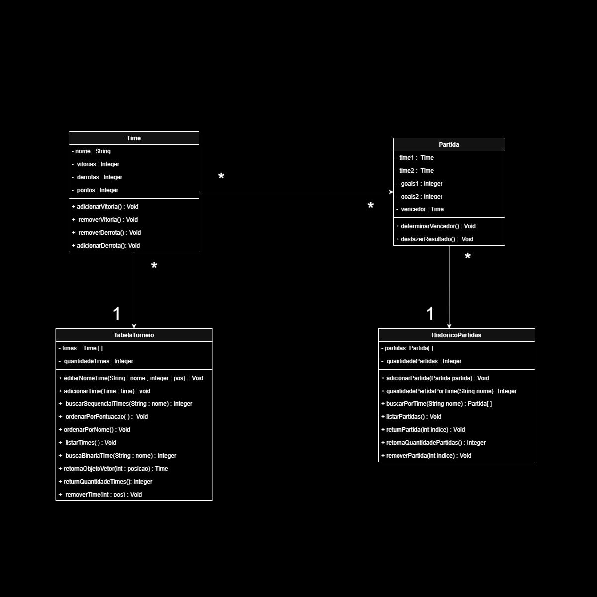

# E-Sports — Sistema Gerenciador de Torneios

Projeto acadêmico desenvolvido em **Java** para as disciplinas de **Estruturas de Dados I** e **Programação Orientada a Objetos**.

O sistema simula o gerenciamento de um torneio de E-Sports, permitindo controlar times, partidas, histórico e classificação. O projeto utiliza **vetores estáticos**, **buscas manuais** e **algoritmos de ordenação implementados sem métodos prontos da API do Java**.

## Funcionalidades

- Cadastro, consulta, edição e remoção de times
- Cadastro, consulta e remoção de partidas
- Atualização automática de vitórias, derrotas e pontuação
- Reversão do resultado dos times ao remover uma partida
- Histórico de partidas
- Busca de partidas pelo nome do time
- Busca binária de times pelo nome
- Ordenação alfabética dos times
- Classificação por pontuação
- Desempate pelo maior número de vitórias
- Validação para impedir partida de um time contra ele mesmo

## Estrutura do projeto

- **Time** — armazena nome, vitórias, derrotas e pontuação do time.
- **Partida** — representa uma partida entre dois times, registra o placar e determina o vencedor.
- **HistoricoPartidas** — gerencia o vetor de partidas, consultas e remoções.
- **TabelaTorneio** — gerencia os times, buscas, ordenações e classificação.
- **Mavenproject1** — classe principal responsável pelos menus e integração do sistema.

## Estruturas utilizadas

O projeto trabalha com vetores de capacidade fixa:

- **20 times**
- **50 partidas**

Atualmente, o programa inicia com **10 times** e **20 partidas de teste**, deixando espaço para novos cadastros durante a execução.

## Algoritmos implementados

As buscas e ordenações foram desenvolvidas manualmente, sem utilizar `Arrays.sort()`, `Collections.sort()` ou `Arrays.binarySearch()`.

- Bubble Sort
- Busca sequencial
- Busca binária

## Diagrama de classes

<p align="center">
  
</p>

## Tecnologias

- Java
- Maven

## Como executar

1. Clone o repositório:

```bash
git clone https://github.com/VictorAms12/E-Sports.git
```

2. Abra a pasta do projeto em uma IDE com suporte a Java e Maven.

3. Execute a classe principal:

```text
POOeED1.Mavenproject1
```

## Objetivo acadêmico

O projeto foi desenvolvido para praticar conceitos de:

- Programação Orientada a Objetos
- Vetores estáticos
- Busca sequencial e busca binária
- Algoritmos de ordenação
- Manipulação manual de estruturas de dados

## Alunos

Integrantes do grupo:

- Victor Alexandre
- Heitor de Sousa
- João Gabriel
- Ricardo Leite
